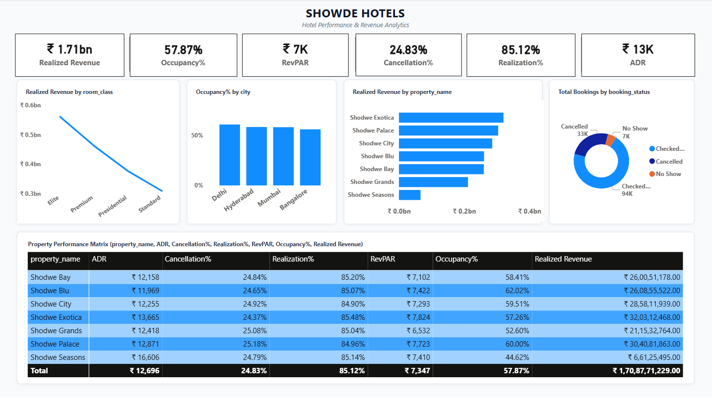

# Hospitality Analytics — Hotel Revenue & Occupancy (Excel · SQL · Power BI · Tableau)

An end-to-end analysis of **134,590 hotel bookings** across **25 hotels in 4 Indian cities** (Mumbai, Bangalore, Hyderabad, Delhi) from **May–July 2022**. The goal: measure hotel performance with the industry's standard KPIs, such as **ADR, RevPAR, Occupancy, Cancellation and Realization**, and find where revenue is won or lost.

The same KPIs are built in four tools, so the numbers can be cross-checked against each other.



---

## Headline results

| KPI | Value | Definition |
|---|---|---|
| Realized revenue | **₹1.71 bn** (₹1,70,87,71,229) | Revenue actually collected |
| Revenue generated | ₹2.01 bn | Revenue at booking time, before cancellations/no-shows |
| Occupancy | **57.87%** | Successful bookings ÷ room capacity |
| ADR (Average Daily Rate) | **₹12,696** | Realized revenue ÷ bookings |
| RevPAR | **₹7,347** | Realized revenue ÷ total room capacity |
| Cancellation rate | **24.83%** | Cancelled bookings ÷ all bookings |
| Checked-out rate | **70.15%** | Checked-out bookings ÷ all bookings |
| Revenue realization | **85.12%** | Realized revenue ÷ generated revenue |
| Average guest rating | **3.62 / 5** | Mean of ratings given |

## Key insights

1. **Mumbai is the revenue engine.** It brought in ₹668.6M realized revenue, more than Bangalore (₹420.4M), Hyderabad (₹325.2M) or Delhi (₹294.5M).
2. **About 1 in 4 bookings is cancelled, and the booking channel isn't the cause.** The cancellation rate is between 24.3% and 25.0% on every platform, whether direct, OTA or offline. Changing channel strategy won't fix it. Look at cancellation policy and lead time instead.
3. **15% of booked revenue is never collected.** ₹2.01 bn generated vs ₹1.71 bn realized. That gap is the size of the prize for tighter cancellation and no-show policies.
4. **Weekdays are the problem, not weekends.** Occupancy is **73.6% on weekends but only 51.3% on weekdays**, which pulls the overall rate down to 57.87%. Weekday pricing, corporate deals and promotions are the main growth lever.

---

## What's in this folder

| Folder | Contents |
|---|---|
| `data/` | All 5 source tables (`dim_date`, `dim_hotels`, `dim_rooms`, `fact_aggregated_bookings`, `fact_bookings`) + `data_dictionary.txt` |
| `sql/` | `hospitality_kpi_analysis.sql`: data validation (row counts, nulls, orphan keys, duplicates) followed by 15 KPI queries (MySQL) |
| `excel/` | Cleaned data, pivot analysis (weekly revenue, city, room category, booking platform) and an executive dashboard |
| `powerbi/` | `.pbix`: KPI cards, occupancy by city, revenue by room class and property, booking-status split, property performance matrix |
| `tableau/` | `.twbx`: 22 worksheets combined into one interactive dashboard (filters for room class, city, month) |
| `presentation/` | Final project deck (PDF for viewing, PPTX for editing) |
| `images/` | Dashboard screenshots |

## Data model

A star schema with two fact tables:

```
                dim_date (date, mmm yy, week no, day_type)
                    │
dim_hotels ─── fact_bookings ─── dim_rooms
(property_id,   (one row per booking:    (room_id → room_class:
 name, category,  status, revenue,         Standard, Elite,
 city)            platform, rating …)      Premium, Presidential)
     │
     └──── fact_aggregated_bookings (property × date × room: successful_bookings, capacity)
```

- `fact_bookings` gives revenue, booking status, cancellations and ratings.
- `fact_aggregated_bookings` gives **capacity**, which is needed for Occupancy and RevPAR.

## Process

1. **Validate (SQL):** check row counts, nulls in key columns, orphan keys against every dimension, and duplicate bookings. Convert `dim_date.date` from text to `DATE`.
2. **Prepare (Excel / Power Query):** standardise labels, build pivots for weekly revenue, city, room category and platform.
3. **Model and measure (Power BI):** star schema, DAX measures for every KPI, property comparison matrix.
4. **Explore (Tableau):** calculated fields for occupancy, cancellation and realization; trend, city, room-class, platform and rating views.
5. **Present:** insights and recommendations deck.

## Tools
MySQL · Excel (Power Query, PivotTables, PivotCharts) · Power BI (DAX, data modelling) · Tableau (calculated fields, dashboard actions)

---

*Data: a public-style hotel bookings dataset (fictional "ShodweStay" hotel brand), based on the Codebasics AtliQ Grands hospitality challenge data.*
